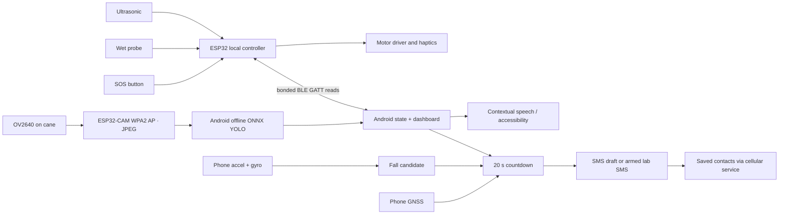

# System architecture and contracts



## Local loop

Range every 65 ms, and `pulseIn` max 24.5 ms. At 20°C cm ≈ pulse µs ×0.01715. A valid short echo ≤90 cm enters near promptly, and three readings ≥105 cm release it. Missing echo uses sentinel and can count toward release. Open space and a sensor failure can produce the same timeout, so the dashboard says distance unavailable. Add a startup removable target check and monitor stuck ECHO on bench. Thresholds must be calibrated for cane swing, range and walking speed.

Water starts a pulse every 100 ms, samples ≥12 ms after excitation and restores IO32 low. Three wet samples trigger (raw ≥1200), five dry clear (≤850). The loop may delay an action by one echo timeout. Near haptic repeats about 145 ms on per 220 ms, SOS local acknowledgement uses a long pattern for ~850 ms, water is two short taps each 850 ms. Near masks all lower haptics. App emergency cue/countdown has top audio priority while local motor keeps serving near obstacles. Camera context is muted during alerts/lost or stale BLE. Power off hardware when stored. Unplug the separate camera branch for local-only runs. GPS requested per incident rather than sampled continuously.

## GATT v1

Advertised service `6f7d0001-48c0-4d8c-bf23-dcb46985b611`. Protected read characteristic `6f7d0002-48c0-4d8c-bf23-dcb46985b611`. Android polls one outstanding read every ~250 ms. Firmware refreshes ~150 ms and on new SOS. Packet is 18 bytes, LE, fits ATT default payload.

| Offset | Type | Meaning |
|---:|---|---|
| 0 | u8 | Version 1 |
| 1 | u8 | Near bit0, wet bit1, echo unavailable bit2, unexpired SOS bit3 |
| 2 | u16 | Packet sequence, wraps |
| 4 | u16 | Distance cm, 65535 unavailable |
| 6 | u16 | ADC raw, 0–4095 |
| 8 | u32 | Random boot identifier |
| 12 | u32 | SOS count since boot |
| 16 | u16 | SOS age ms valid under 60,000, else 65535 |

Diagnostic example, decoded from binary, no cloud transport.

```json
{"version":1,"seq":234,"distance_cm":74,"near":true,"wet":false,"echo_unavailable":false,"water_raw":190,"battery_percent":null,"boot_id":2840892214,"sos":{"event_id":3,"age_ms":210}}
```

USB serial enrollment per-unit PIN, encrypted MITM characteristic, Android bonding. Bench only pairing workflow with device isolation during discovery. For release, authorize one bonded device under a physical pairing window and implement controlled reset/forget flow. No writable controls in the prototype. On connection loss the UI clears readings, starts retry for the selected bond after 2.5 s, and expires recent button events after 60 s. For production persist and acknowledge a bounded event queue with explicit lost-event handling. Track reading age separately from link state.

## Android emergency and lifecycle

The starter implements Idle → Candidate (mock/IMU/physical button/phone button) → Confirm/cancel countdown → Cancelled / Expired → Draft or Lab submit. Real events can supersede a mock. Mock expiry only changes UI. IMU uses near-50 Hz accelerator/gyro, unloading <0.55 g, impact ≥2.5 g within 750 ms, integrated angular motion ≥0.65 rad, then ≥1.8 s stillness. These are experimental initial values, not a trained or validated fall detector. A phone in a bag, on a table or dropped can produce misses or false positives. Use a secure body pouch for tests. Add support for slow falls and verify against daily activities before using automatic sends outside the lab.

Location requests precise foreground GNSS with a ≤60 s old fix and ≤100 m estimated accuracy. Use GPS coordinates inside the text only with a usable fix. Indoor or approximate/denied permission falls back to SOS without coordinates. No road routing or continuous GPS. Default demo uses `ACTION_SENDTO`, opens recipient draft and awaits Send. Lab variant is sideload only and gated by explicit live arming, visible activity, SEND_SMS and selected default SIM. It dispatches only after expiry. A platform sent callback is not a delivery receipt. Record actual recipient receipt in controlled tests. If cellular is unavailable, keep a draft with clear state; no cloud or automatic retry. Carrier charges and range apply. GPS position can be obtained without mobile data given adequate GNSS reception; opening a map link can need data.

For screen-off work, implement a user-started walking-session foreground service with `connectedDevice` and a persistent accessible notification while maintaining BLE access. For fall detection, check the appropriate foreground-service type requirements on target Android and Play policy. Use explicit user activation, notification/cancel actions, screen-off/OEM testing and monotonic timers backed by persisted incident state. If continuous location is required later, use the location service type and evaluate background permission and while-in-use limits separately. Continuous sensors are restricted for background apps. Starter listens for IMU only while Activity is visible. Android 12+ nearby BLE runtime permissions, Android 13+ nearby Wi-Fi permission and notification permission for future status notifications, API 31–32 Wi-Fi request location requirements, approximate/precise location choices, and restrictions on launching an Activity/service in background matter. User can end the walk session or revoke permissions anytime. Play restricts SMS permissions, so review permitted exception and obtain approval before any distribution that requests SEND_SMS. Keep the composer for general distribution.

Sources. [Android BLE permissions](https://developer.android.com/develop/connectivity/bluetooth/bt-permissions) · [Background BLE](https://developer.android.com/develop/connectivity/bluetooth/ble/background) · [Foreground service types](https://developer.android.com/about/versions/14/changes/fgs-types-required) · [Android sensor restrictions](https://developer.android.com/develop/sensors-and-location/sensors/sensors_overview) · [SmsManager](https://developer.android.com/reference/android/telephony/SmsManager) · [Google Play SMS restrictions](https://support.google.com/googleplay/android-developer/answer/10208820)
