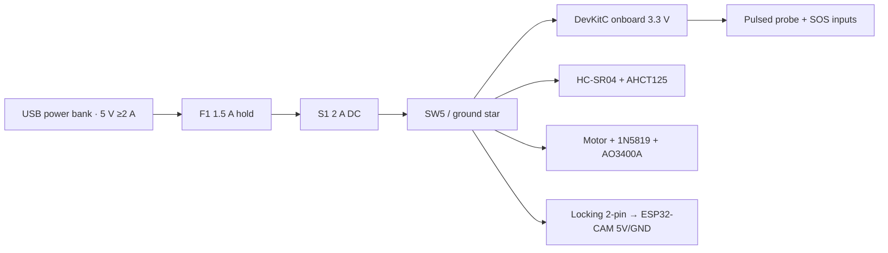

# Power and placement

1. Mark +/− on the USB pigtail with a meter. Use a current-limited 5.0 V bench supply at first. Start with the MCU unplugged from the circuit and mains. Leave the camera and motor branches out.
2. With power off, verify continuity for each net in `../schematics/nets.tsv`. Check no short from SW5 to GND. Capacitors may briefly look like a short as they charge. Verify the diode stripe goes to SW5 and all electrolytic negative terminals go to GND.
3. Scope buffered trigger at U2 and the echo divider output using a wall at 60 cm. Connect IO27 only after confirming the divider voltage. Add motor, then water and SOS. Flash and test local behavior. Add the camera last. Keep a common return and route motor current independently of the analog ground.
4. Use 22–24 AWG stranded power wire and locking connectors for moving assemblies. Stay on perfboard after bench tests. Add heat-shrink, grommets and strain relief. Keep the battery and motor close to the grip. Test a removable mount before drilling or modifying the cane. Keep the tip free to sweep.
5. Keep the ultrasonic faces uncovered with a drip hood and the lens behind a clean optical window. Mount the exposed electrodes at roughly 5–10 mm clearance on a replaceable insulated mount. Run probe wires separately and add a drip loop. Keep the enclosure and USB ports dry. Conduct splash experiments on detached unpowered housings before energized tests.
6. Set the camera behind the forward ultrasonic axis at grip height. Record mount height, yaw and pitch under normal grip. A reference target at 1 m establishes the nominal alignment. Adjust from field measurements, then secure both brackets and record their settings.
